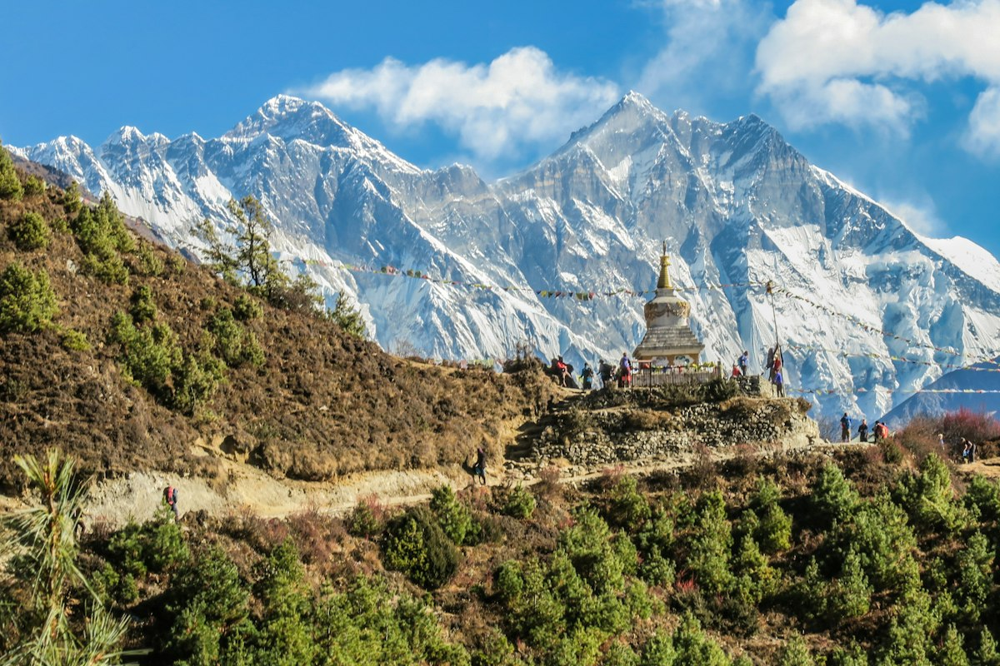

# ALTITUDE — Guided Himalayan Treks

> A single-page marketing website for **Altitude**, a guided Himalayan trekking company for groups of 6–10 college students and young professionals. Designed with a premium outdoor magazine feel, featuring real-time 3D procedural alpine terrain, scroll-scrubbed physics, and an editorial design system.



## 🏔️ Tech Stack
- **Framework**: React 19 + TypeScript + Vite
- **Styling**: Tailwind CSS with strict CSS Variable design tokens
- **3D Graphics**: Three.js (Procedural ridged multifractal terrain, dynamic slope/altitude snow shader, volumetric clouds, and 3D falling snow particles)
- **Animation**: GSAP + ScrollTrigger (pinned horizontal trek deck, scrubbed parallax) & Lenis Smooth Scroll
- **Micro-Interactions**: Framer Motion (magnetic buttons, masked word reveals, bento tilt spotlights)
- **Icons**: Lucide Icons (stroke width 1.5)

## 🎨 Design System
- **Light Theme**: Warm paper (`#F5F2EC`), surface (`#FFFFFF`), text (`#15171A`), border (`#E3DED4`), ember orange accent (`#D9480F`), pine green secondary (`#1F3A2E`).
- **Dark Theme**: Deep nocturnal base (`#0E1110`), charcoal surface (`#161A18`), warm bone text (`#EDEAE3`), border (`#26302B`), flame accent (`#FF6B35`), moss secondary (`#8FB9A0`).
- **Typography**: Fraunces (Headings), Manrope (Body), JetBrains Mono (Metrics & Small Labels).
- **Film Grain**: 4% opacity organic noise overlay.

## 🚀 Local Development

```bash
# Clone the repository
git clone https://github.com/Puneet-S16/ALTITUDE.git
cd ALTITUDE

# Install dependencies
npm install

# Start development server
npm run dev
```

## 📦 Build for Production

```bash
npm run build
npm run preview
```

## 🌐 Deployment
This project is configured for automated deployment to **GitHub Pages** via GitHub Actions. Pushing to the `main` branch automatically triggers the build and publish workflow.

---
© 2026 Altitude Trekking Co. All rights reserved.
